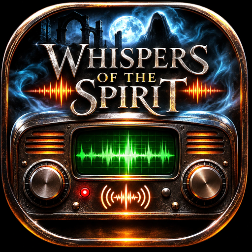
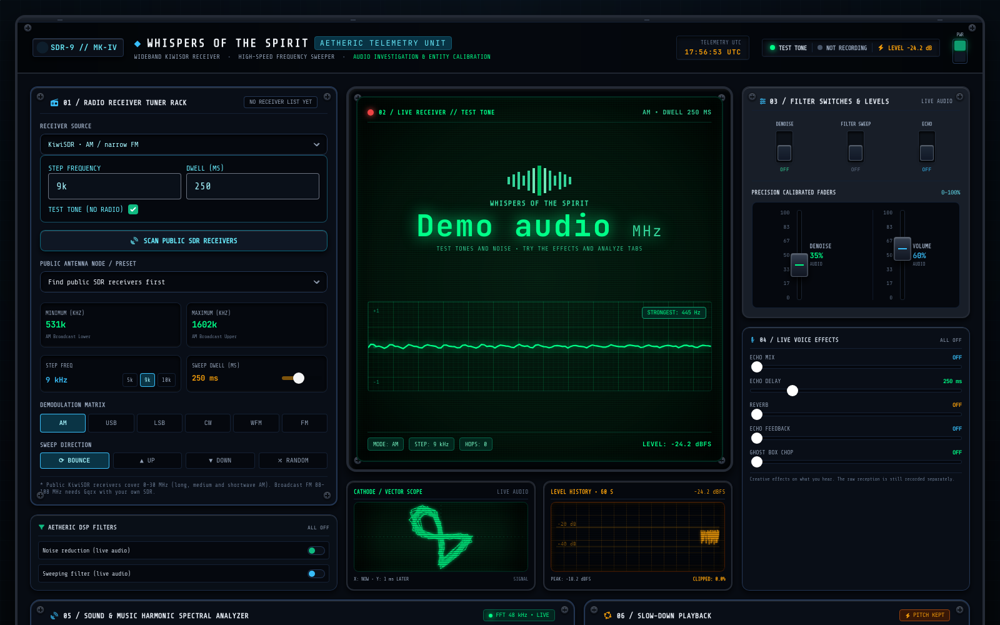
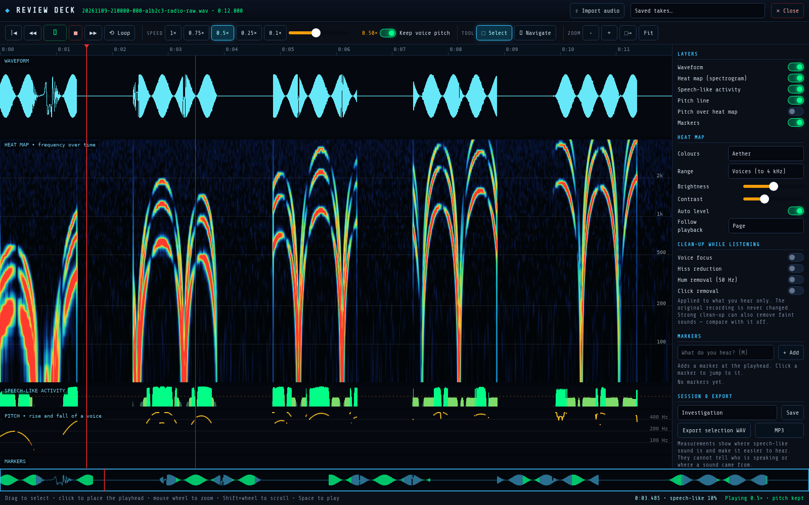
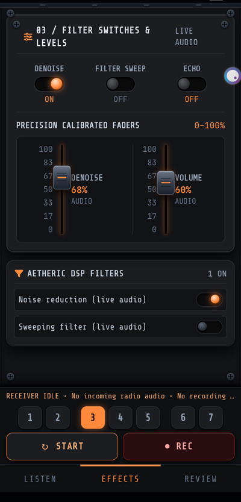
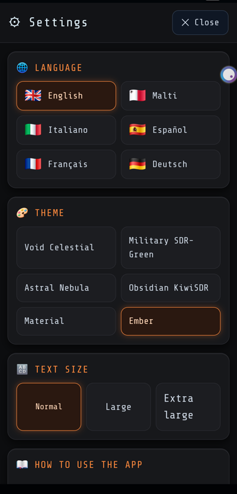
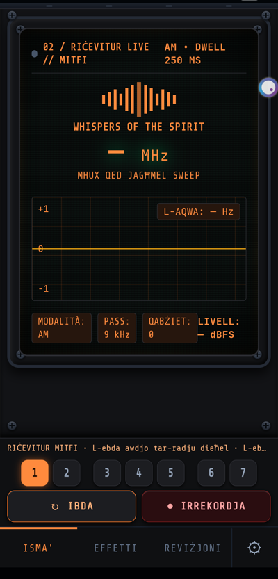
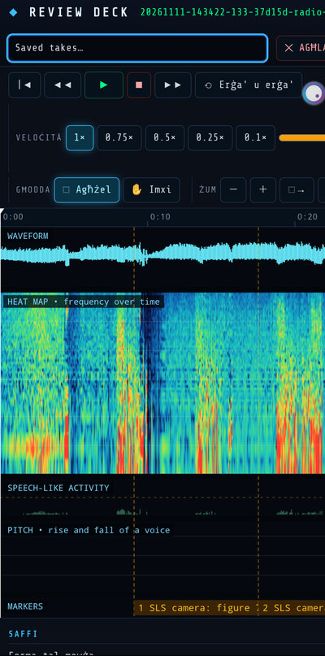

<p align="center">
  
</p>

<h1 align="center">Whispers of the Spirit</h1>

<p align="center">
  <b>A ghost-box and EVP radio investigation console for Windows, Linux and Android.</b><br>
  Sweep real radio receivers, listen to internet radio, record what comes through —
  then slow it down and study every whisper.
</p>

<p align="center">
  <a href="https://github.com/debattistacliff-commits/whispers-of-the-spirit/releases/latest"></a>
  
  
  <a href="LICENSE"></a>
  
</p>

<p align="center">
  <a href="#-download">Download</a> ·
  <a href="#-features">Features</a> ·
  <a href="#-screenshots">Screenshots</a> ·
  <a href="#-install">Install</a> ·
  <a href="#-project-status-and-collaborators">Collaborate</a> ·
  <a href="DISCLAIMER.md">Disclaimer</a> ·
  <a href="#-licence-and-rights">Licence</a>
</p>

---

## ⬇ Download

Free to download and use. Files are on the **[Releases page](https://github.com/debattistacliff-commits/whispers-of-the-spirit/releases/latest)**.

| Platform | Download | Requirements |
| --- | --- | --- |
| 🪟 **Windows** 10 / 11 (64-bit) | [**Whispers-of-the-Spirit-2.0-Windows-x64-Installer.zip**](https://github.com/debattistacliff-commits/whispers-of-the-spirit/releases/latest/download/Whispers-of-the-Spirit-2.0-Windows-x64-Installer.zip) | Extract, then double-click `Install Whispers of the Spirit.bat`. FFmpeg optional (see below). |
| 🐧 **Linux** 64-bit PC (Ubuntu 22.04+, Debian 12+, Fedora 39+, Mint 21+) | [**Whispers-of-the-Spirit-2.0-Linux-x64.tar.gz**](https://github.com/debattistacliff-commits/whispers-of-the-spirit/releases/latest/download/Whispers-of-the-Spirit-2.0-Linux-x64.tar.gz) | A few free system packages (one command, see below). |
| 🤖 **Android** 7.0+ | [**Whispers-of-the-Spirit-2.2-Android.apk**](https://github.com/debattistacliff-commits/whispers-of-the-spirit/releases/latest/download/Whispers-of-the-Spirit-2.2-Android.apk) | Allow installing apps from this source. New in 2.2: the **SLS camera**. |

Check your download against [`SHA256SUMS.txt`](https://github.com/debattistacliff-commits/whispers-of-the-spirit/releases/latest/download/SHA256SUMS.txt).

> ⚠️ **Please read the [Disclaimer](DISCLAIMER.md).** This is an entertainment and hobby-research
> tool. It does not detect or prove spirits; the voices you hear come from real radio, streams,
> static, your microphone or the app's effects.

## ✨ Features

- 📻 **Receiver rack** — public KiwiSDR receivers worldwide (0–30 MHz: long, medium and
  shortwave AM), live internet radio stations, or Gqrx with your own SDR for broadcast FM.
  Sweep up, down, bounce or random, with your own step and dwell time — the classic ghost-box sweep.
- 📈 **Live analyser** — spectrum bars, waveform, X/Y scope and a one-minute level history of
  the incoming audio, measured *before* any effects.
- 🎛 **Live voice effects** — echo, echo delay and feedback, reverb and ghost-box chop on what
  you hear. The raw reception is always recorded separately and untouched.
- 🎙 **EVP sessions** — record the received audio and, separately, your own questions from the
  microphone; both are joined into one time-stamped conversation file.
- 🔬 **Review deck** — full-screen review of any recording:
  - stacked lanes: waveform, heat map (spectrogram), speech-like activity, pitch line and your markers;
  - slow down to 0.75×, 0.5×, 0.25× or 0.1× **keeping the voice pitch**, or tape-style;
  - clean-up while listening: voice focus, hiss reduction, 50 Hz hum removal, click removal;
  - zoom with the mouse wheel, loop a selection, add notes as markers, save sessions,
    export the selection as WAV or MP3.
- 🎨 **Console skins** — Void Celestial, Military SDR-Green, Astral Nebula, Obsidian KiwiSDR,
  and on Android also **Material** and **Ember** (charcoal and glowing orange hardware look).
- 📱 **Made for the phone (Android 2.1)** — screen-sized pages you swipe through with your
  finger, numbered page buttons, big readable text, and **Start / Rec always at the bottom**.
  Sliders move only after a touch-and-hold, so swiping never changes a setting by accident.
- 🌐 **Languages (Android 2.1)** — 🇬🇧 English, 🇲🇹 Malti, 🇮🇹 Italiano, 🇪🇸 Español, 🇫🇷 Français and
  🇩🇪 Deutsch, chosen with their flags in ⚙ Settings, together with theme, text size, a
  step-by-step *How to use* guide and *About*.
- 📷 **SLS camera (Android 2.2)** — the phone camera with a stick-figure overlay that marks
  *body-like shapes*, an SLS intensity bar, a sensitivity slider and a motion meter.
  - Visual filters: night-vision green, X-ray, thermal-style, UV-style, spirit edges, ember and plain
    (colour effects only — no real heat or X-ray).
  - ⏺ Record video with the overlay and a date/time stamp, 📸 take pictures, and find them in
    🕘 History (play, share, name the place, delete).
  - Keep the radio on: while a radio recording runs, every figure the camera sees puts an
    **"SLS camera" marker** on that recording, so it lines up in the Review deck.
  - Optional 🔔 alert sound. Runs on the phone without internet; the camera is on only while the
    SLS page is open. It finds body-like shapes — it does not detect spirits.
- 🔌 **Works offline** — styles, fonts and icons are built in. Your recordings stay on your device.

The original recording is never changed. Measurements show *where* speech-like sound is and
make it easier to hear; they cannot tell *who* is speaking or *where* a sound came from.

## 🖼 Screenshots

**Investigation console** — live receiver, analyser, scope, level history and effects:

<p align="center"></p>

**Review deck** — a recording slowed to 0.5× with the voice pitch kept, with heat map,
speech-like activity and pitch line:

<p align="center"></p>

**On the phone (Android 2.1)** — Effects page in the Ember skin, Settings with languages and flags,
and the Listen page in Maltese:

<p align="center">
  
  
  
</p>

**SLS camera (Android 2.2)** — the camera page with the night-vision filter, the History of saved
videos and pictures, and camera markers lined up with a radio recording in the Review deck:

<p align="center">
  
  
  
</p>

## 🛠 Install

### Windows
1. Download the Windows installer ZIP and **extract it** (right-click → *Extract All…*).
2. Double-click **`Install Whispers of the Spirit.bat`** in the extracted folder.
   If Windows SmartScreen appears, choose *More info → Run anyway* (the app is not code-signed).
3. Optional, for pitch-keeping slow-down, clean-up and MP3: install FFmpeg —
   `winget install Gyan.FFmpeg`.

### Linux
1. Install the system parts once:
   - Ubuntu / Debian / Mint:
     `sudo apt install libwebkit2gtk-4.1-0 libpulse0 libvlc5 vlc-plugin-base ffmpeg`
   - Fedora: `sudo dnf install webkit2gtk4.1 pulseaudio-libs vlc-libs ffmpeg` (VLC and FFmpeg from RPM Fusion)
2. Unpack: `tar -xzf Whispers-of-the-Spirit-2.0-Linux-x64.tar.gz`
3. Start: `./Whispers-of-the-Spirit-2.0-Linux-x64/whispers-of-the-spirit`
   — or run `./install-desktop-entry.sh` in that folder to add it to your applications menu.

Works with PulseAudio and PipeWire. .NET is included in the package.

### Android
1. Download the APK on your phone and open it.
2. Allow *Install unknown apps* for your browser or file manager when asked.
3. Grant microphone permission if you want to record your questions, and camera permission
   ("While using the app") for the SLS camera.
4. Swipe left and right (or tap the page numbers) to move between pages; the **SLS** tab opens the camera; tap **⚙** for language, theme,
   text size, the *How to use* guide and *About*. Touch and hold a slider to move it.

## 🧭 Platform differences

| Feature | Windows | Linux | Android |
| --- | :---: | :---: | :---: |
| Receivers, internet radio, recording, live effects and analyser | ✓ | ✓ | ✓ |
| Review deck: WAV recordings, all lanes, markers, sessions | ✓ | ✓ | ✓ |
| Review deck: slow-down | pitch kept or tape-style | pitch kept or tape-style | tape-style |
| Review deck: clean-up while listening, MP3/FLAC import, MP3 export | with FFmpeg | with FFmpeg | — |
| Swipe pages, ⚙ Settings, languages, Material and Ember skins | coming soon | coming soon | ✓ (2.1) |
| SLS camera: body-shape overlay, filters, video, History, radio markers | coming soon | coming soon | ✓ (2.2) |

Pitch-keeping slow-down, clean-up and MP3/FLAC use the free **FFmpeg** program (with Rubber Band
support). Without it the deck plays tape-style and says so. Android has no FFmpeg.

## ❓ FAQ

**Does this app talk to spirits?**
No app can prove that. Whispers of the Spirit gives you good tools to listen, record and review
honestly. What you make of the results is yours — see the [Disclaimer](DISCLAIMER.md).

**Where are my recordings?**
Windows and Android: in the app's own data folder (export them from the Review deck).
Linux: `~/.local/share/whispers-of-the-spirit`.

**Is anything sent to the internet?**
Only what you choose to listen to: radio streams, the public station directory and public
KiwiSDR receivers. Optional transcription runs on your own computer (`SpeechServer/`).

## 🧑‍💻 Build from source

The source is published so you can see how it works and build it for your own personal use
(see [LICENSE](LICENSE)).

Requirements: .NET 10 SDK. Windows/Android also need the MAUI workloads
(`dotnet workload install maui-windows maui-android`) and, for Android, the Android SDK and a JDK.
Linux needs only the plain .NET 10 SDK and is built on Linux or WSL.

```powershell
# Windows app into .\out\Windows-x64
./scripts/build-windows.ps1

# Android APK into .\out\Android (set your SDK and JDK folders)
./scripts/build-android.ps1 -AndroidSdk C:\path\to\android-sdk -JavaSdk C:\path\to\jdk
```

```bash
# Linux package into ./out/Whispers-of-the-Spirit-2.0-Linux-x64.tar.gz
./scripts/build-linux.sh
```

```powershell
# Automated checks
dotnet run --project Ghostbox.Checks
dotnet run --project Whispers.Checks     # needs FFmpeg
```

The console page lives in `Ghostbox.App/WebConsole/`. After changing its HTML or scripts,
rebuild the offline stylesheet: `cd Ghostbox.App/WebConsole/tools && npm install && npm run build`.

<details>
<summary>Repository layout</summary>

| Folder | Contents |
| --- | --- |
| `Ghostbox.App/` | The Windows/Android app (.NET MAUI). `WebConsole/` holds the console page, live wiring and Review deck. |
| `Ghostbox.Linux/` | The Linux app: the same `Ghostbox.App` code and console page in a WebKitGTK window (Photino.NET), with Linux sound, dialogs and settings. |
| `Ghostbox.Core/` | Radio, audio, analysis and file code shared by the apps and the checks. |
| `Ghostbox.Checks/`, `Whispers.Checks/`, `Ghostbox.RadioChecks/` | Automated checks. |
| `SpeechServer/` | Optional local transcription helper (Python). |
| `assets/icon/` | App logo and icons. |
| `docs/` | Screenshots, feature notes, design and validation history, development notes. |
| `scripts/` | Build scripts. |

</details>

## 🤝 Project status and collaborators

I keep maintaining Whispers of the Spirit and will keep making it better, and more projects are
on the way. Collaborators are very welcome — whether you can help with code, testing,
translations or ideas. Open an [issue](https://github.com/debattistacliff-commits/whispers-of-the-spirit/issues)
to say hello, report a problem or suggest something, and we can agree how to work together.

## ⚖ Licence and rights

**Copyright © 2026 debattistacliff-commits. All rights reserved.**

You may download and use the app free of charge for personal, non-commercial use, and read the
source code. You may **not** sell, re-upload, redistribute or publish modified versions, or use
the code, the name *Whispers of the Spirit*, the logo or artwork elsewhere, without written
permission. Full terms: [LICENSE](LICENSE). To ask for permission, open an issue.

Third-party components keep their own licences — see [THIRD-PARTY.md](THIRD-PARTY.md) and the
`Licenses/` folder. Broadcast audio belongs to its broadcasters.

## 🙏 Acknowledgements

[KiwiSDR](http://kiwisdr.com/) receiver operators · [Radio Browser](https://www.radio-browser.info/) ·
[VideoLAN / LibVLC](https://www.videolan.org/) · [FFmpeg](https://ffmpeg.org/) and
[Rubber Band](https://breakfastquay.com/rubberband/) · [.NET MAUI](https://github.com/dotnet/maui) ·
[Photino](https://www.tryphotino.io/) · [NAudio](https://github.com/naudio/NAudio) ·
[Google MediaPipe](https://github.com/google-ai-edge/mediapipe).

<p align="center"><sub>Made for the ghost-hunting and EVP community. Investigate respectfully, and stay safe. 👻</sub></p>
