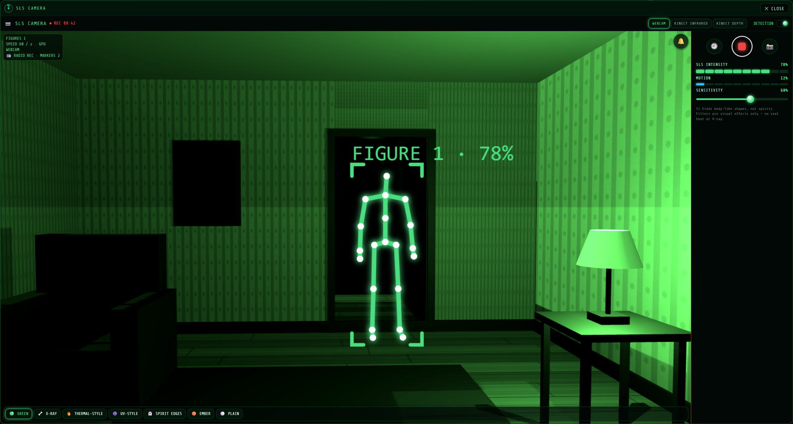
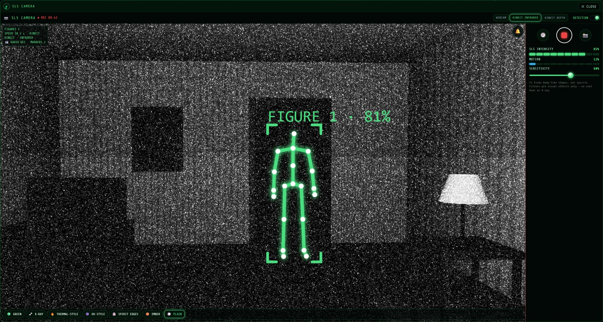
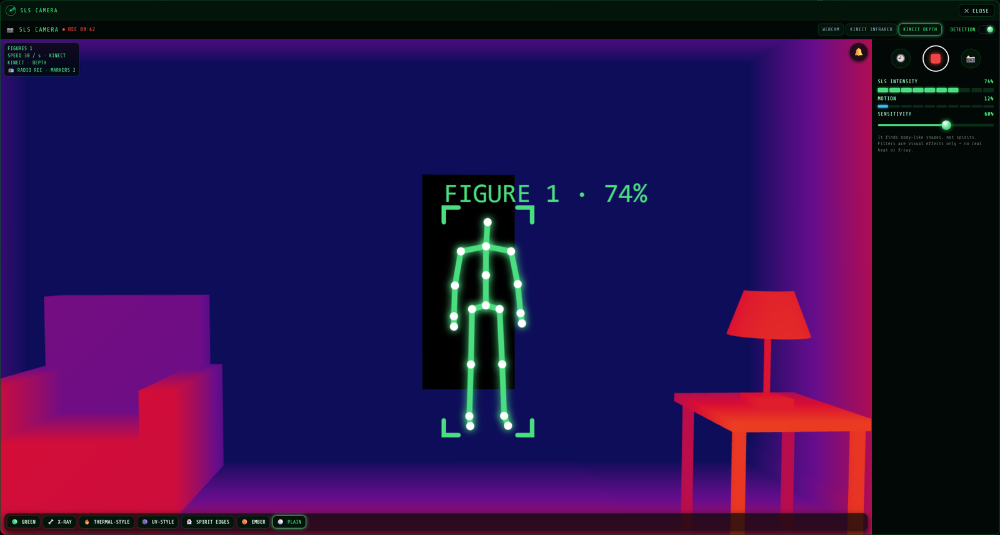
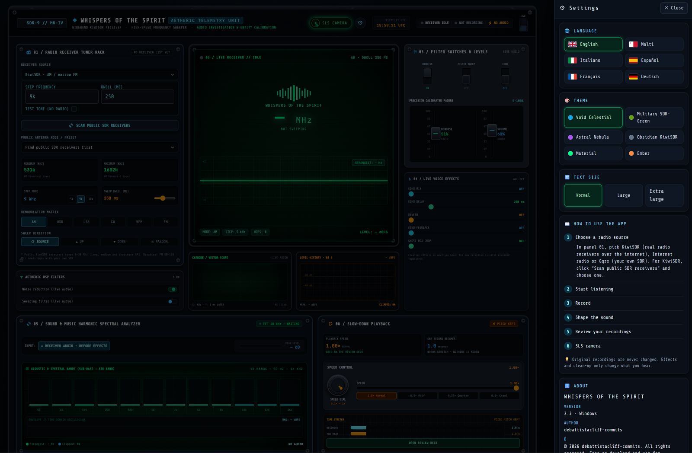

<p align="center">
  
</p>

<h1 align="center">Whispers of the Spirit</h1>

<p align="center">
  <b>A ghost-box, EVP and SLS camera investigation console for Windows, Linux and Android.</b><br>
  Sweep real radio receivers, record what comes through, watch the room with the SLS camera —
  then slow it all down and study every whisper.
</p>

<p align="center">
  <a href="https://github.com/debattistacliff-commits/whispers-of-the-spirit/releases/latest"></a>
  
  
  <a href="LICENSE"></a>
  
</p>

<p align="center">
  <a href="#-download">Download</a> ·
  <a href="#-features">Features</a> ·
  <a href="#-the-sls-camera">SLS camera</a> ·
  <a href="#-screenshots">Screenshots</a> ·
  <a href="#-install">Install</a> ·
  <a href="#-project-status-and-collaborators">Collaborate</a> ·
  <a href="DISCLAIMER.md">Disclaimer</a> ·
  <a href="#-licence-and-rights">Licence</a>
</p>

---

## ⬇ Download

Free to download and use. All files are on the **[Releases page](https://github.com/debattistacliff-commits/whispers-of-the-spirit/releases/latest)**.

| Platform | Download | How to install |
| --- | --- | --- |
| 🪟 **Windows** 10 / 11 (64-bit) | [**Whispers-of-the-Spirit-2.3-Windows-x64-Installer.zip**](https://github.com/debattistacliff-commits/whispers-of-the-spirit/releases/latest/download/Whispers-of-the-Spirit-2.3-Windows-x64-Installer.zip) | Extract the ZIP, then double-click **`Install Whispers of the Spirit.bat`**. |
| 🐧 **Linux** 64-bit PC (Ubuntu 22.04+, Debian 12+, Fedora 39+, Mint 21+) | [**Whispers-of-the-Spirit-2.3-Linux-x64.tar.gz**](https://github.com/debattistacliff-commits/whispers-of-the-spirit/releases/latest/download/Whispers-of-the-Spirit-2.3-Linux-x64.tar.gz) | Install a few free system packages, unpack and start (see [Install](#-install)). |
| 🤖 **Android** 7.0+ | [**Whispers-of-the-Spirit-2.3-Android.apk**](https://github.com/debattistacliff-commits/whispers-of-the-spirit/releases/latest/download/Whispers-of-the-Spirit-2.3-Android.apk) | Open the APK on your phone and allow installing from this source. |

Check your download against [`SHA256SUMS.txt`](https://github.com/debattistacliff-commits/whispers-of-the-spirit/releases/latest/download/SHA256SUMS.txt).

> ⚠️ **Please read the [Disclaimer](DISCLAIMER.md).** Whispers of the Spirit is an entertainment and
> hobby-research tool. It does not detect or prove spirits: the voices come from real radio, streams,
> static, your microphone or the app's effects, and the SLS camera finds *body-like shapes*, not spirits.

## ✨ Features

### 📻 Listen
- **Receiver rack** — public KiwiSDR receivers worldwide (0–30 MHz: long, medium and shortwave AM),
  live internet radio stations, or Gqrx with your own SDR for broadcast FM.
- **Ghost-box sweep** — up, down, bounce or random, with your own step and dwell time.
- **Live analyser** — spectrum bars, waveform, X/Y scope and a one-minute level history, measured
  *before* any effects.
- **Live voice effects** — echo, delay, feedback, reverb and ghost-box chop. The raw reception is
  always recorded separately and never changed.

### 🎙 Record and review
- **EVP sessions** — record the received audio and, separately, your own questions from the
  microphone; both are joined into one time-stamped conversation file.
- **Review deck** — a full-screen study of any recording:
  - stacked lanes: waveform, heat map (spectrogram), speech-like activity, pitch line and markers;
  - slow down to 0.75×, 0.5×, 0.25× or 0.1× **keeping the voice pitch**, or tape-style;
  - clean-up while listening: voice focus, hiss reduction, 50 Hz hum removal, click removal;
  - zoom, loop a selection, add notes as markers, save sessions, export WAV or MP3.

### 📷 SLS camera
A camera view that draws a stick-figure skeleton over body-like shapes, with an SLS intensity bar,
sensitivity, a motion meter, visual filters, video recording, pictures and a History.
It works together with the radio — see [The SLS camera](#-the-sls-camera) below.

### ⚙ Settings, languages and themes
- **Six languages** with their flags: 🇬🇧 English · 🇲🇹 Malti · 🇮🇹 Italiano · 🇪🇸 Español · 🇫🇷 Français · 🇩🇪 Deutsch.
- **Themes:** Void Celestial, Military SDR-Green, Astral Nebula, Obsidian KiwiSDR, and the
  hardware-style **Material** and **Ember** (charcoal with glowing orange lights).
- **Text size**, a step-by-step *How to use* guide and *About*.
- **On the phone:** screen-sized pages you swipe through, with **Start / Rec always at the bottom**.
  Sliders move only after a touch-and-hold, so swiping never changes a setting by accident.

### 🔒 Private and offline
Styles, fonts, icons and the SLS body-shape engine are built in. Recordings, videos and pictures
stay on your device until you choose to share them.

The original recording is never changed. Measurements show *where* speech-like sound is and make it
easier to hear; they cannot tell *who* is speaking or *where* a sound came from.

## 📷 The SLS camera

Use the camera you already have. A **Kinect** is an optional extra for investigators who own one.

| Camera | Where | What you get |
| --- | --- | --- |
| 📱 **Phone camera** (front or back, with torch) | Android | Take the phone on an investigation: skeleton overlay, filters, video, pictures, History. |
| 💻 **Laptop or USB webcam** | Windows | The same on a laptop or PC, in a window over the console while the radio keeps playing. |
| 🎮 **Xbox 360 Kinect** *(optional extra)* | Windows | **Infrared night vision** that sees in total darkness, a **depth view** coloured by distance, and the Kinect's own skeleton tracking — the camera the original SLS cameras were built on. |

What every SLS camera can do:
- **Skeleton overlay** on body-like shapes, with an **SLS intensity** bar, **sensitivity** control and a **motion** meter.
- **Visual filters:** night-vision green, X-ray, thermal-style, UV-style, spirit edges, ember and plain
  (colour effects only — no real heat or X-ray).
- **⏺ Record video** with the overlay and a date/time stamp, **📸 take pictures**, and find them in
  **🕘 History** — with the time, the strongest moment, the number of figures and a place name.
- **Radio and camera together:** while a radio recording runs, each figure the camera sees adds an
  **"SLS camera" marker** to that recording, so the moment lines up with the sound in the Review deck.
- **Optional 🔔 alert sound** when a figure appears.
- The camera is on **only while the SLS camera is open**.

> **Using a Kinect (optional).** Any Xbox 360 Kinect with its PC power/USB adapter, or a Kinect for
> Windows v1. Install Microsoft's free **Kinect for Windows Runtime 1.8**, plug in the Kinect, then
> choose **KINECT INFRARED** or **KINECT DEPTH** at the top of the SLS camera window. Without a Kinect,
> the app uses your webcam as usual.

## 🖼 Screenshots

### Windows

**Investigation console** — live receiver, analyser, scope, level history and effects:

<p align="center"></p>

**SLS camera** — webcam with the night-vision filter, recording, with markers going onto the radio recording:

<p align="center"></p>

**With an Xbox 360 Kinect** — infrared night vision (left) and depth (right):

<p align="center">
  
  
</p>

<p align="center"><sub>Illustration: the room in these three camera pictures is computer-generated, and the skeleton shows what a detection looks like.</sub></p>

**Settings** — language with flags, theme, text size, guide and About:

<p align="center"></p>

**Review deck** — a recording slowed to 0.5× with the voice pitch kept, with heat map, speech-like
activity and pitch line:

<p align="center"></p>

### Android

The Effects page in the Ember theme, Settings with languages and flags, and the Listen page in Maltese:

<p align="center">
  
  
  
</p>

SLS camera markers lined up with a radio recording in the Review deck:

<p align="center"></p>

## 🛠 Install

### Windows
1. Download the Windows installer ZIP and **extract it** (right-click → *Extract All…*).
2. Double-click **`Install Whispers of the Spirit.bat`** in the extracted folder. It installs for your
   Windows user (no administrator password), adds a desktop shortcut and opens the app.
   If Windows SmartScreen appears, choose *More info → Run anyway* (the app is not code-signed).
3. Optional: for pitch-keeping slow-down, clean-up and MP3, install FFmpeg — `winget install Gyan.FFmpeg`.
4. Optional: for a Kinect, install the **Kinect for Windows Runtime 1.8** from Microsoft.

The installer only copies files. It never deletes recordings or an earlier version.

### Linux
1. Install the system parts once:
   - Ubuntu / Debian / Mint: `sudo apt install libwebkit2gtk-4.1-0 libpulse0 libvlc5 vlc-plugin-base ffmpeg`
   - Fedora: `sudo dnf install webkit2gtk4.1 pulseaudio-libs vlc-libs ffmpeg` (VLC and FFmpeg from RPM Fusion)
2. Unpack: `tar -xzf Whispers-of-the-Spirit-2.3-Linux-x64.tar.gz`
3. Start: `./Whispers-of-the-Spirit-2.3-Linux-x64/whispers-of-the-spirit` — or run
   `./install-desktop-entry.sh` in that folder to add it to your applications menu.

Works with PulseAudio and PipeWire. .NET is included in the package.

### Android
1. Download the APK on your phone and open it.
2. Allow *Install unknown apps* for your browser or file manager when asked.
3. Allow the microphone to record your questions, and the camera ("While using the app") for the SLS camera.
4. Swipe left and right (or tap the page numbers) to move between pages. The **SLS** tab opens the
   camera; **⚙** opens Settings. Touch and hold a slider to move it.

## 🧭 Platform overview

| Feature | Windows | Linux | Android |
| --- | :---: | :---: | :---: |
| Receivers, internet radio, sweep, recording, live effects and analyser | ✓ | ✓ | ✓ |
| Review deck: lanes, markers, sessions, WAV export | ✓ | ✓ | ✓ |
| Review deck: pitch-keeping slow-down, clean-up, MP3/FLAC (with FFmpeg) | ✓ | ✓ | tape-style slow-down |
| ⚙ Settings, six languages, Material and Ember themes | ✓ | ✓ | ✓ |
| SLS camera with video, pictures, History and radio markers | ✓ webcam | coming later | ✓ phone camera |
| Xbox 360 Kinect: infrared, depth and skeleton tracking | ✓ optional | — | — |
| Swipe pages made for the phone | — | — | ✓ |

## ❓ FAQ

**Does this app talk to spirits?**
No app can prove that. Whispers of the Spirit gives you good tools to listen, record, watch and
review honestly. What you make of the results is yours — see the [Disclaimer](DISCLAIMER.md).

**The SLS camera showed a figure in an empty room. What happened?**
The body-shape detection sometimes sees a figure in furniture, clothes or shadows. Lower the
sensitivity for fewer false alarms, and always check the moment again in your recording.

**Do I need a Kinect?**
No. The SLS camera works with any phone camera or webcam. The Kinect is an optional extra on
Windows for night vision and depth.

**Where are my recordings?**
Windows and Android: in the app's own data folder (the SLS History has *Show file* / *Share*).
Linux: `~/.local/share/whispers-of-the-spirit`.

**Is anything sent to the internet?**
Only what you choose to listen to: radio streams, the public station directory and public KiwiSDR
receivers. The SLS camera runs entirely on your device. Optional transcription runs on your own
computer (`SpeechServer/`).

## 🧑‍💻 Build from source

The source is published so you can see how it works and build it for your own personal use
(see [LICENSE](LICENSE)).

Requirements: .NET 10 SDK. Windows/Android also need the MAUI workloads
(`dotnet workload install maui-windows maui-android`) and, for Android, the Android SDK and a JDK.
The optional Kinect helper builds when the Kinect for Windows SDK 1.8 is installed.

```powershell
# Windows app into .\out\Windows-x64 (add -Installer for the installer ZIP)
./scripts/build-windows.ps1 -Installer

# Android APK (set your SDK and JDK folders)
./scripts/build-android.ps1 -AndroidSdk C:\path\to\android-sdk -JavaSdk C:\path\to\jdk
```

```bash
# Linux package into ./out/Whispers-of-the-Spirit-2.3-Linux-x64.tar.gz
./scripts/build-linux.sh
```

```powershell
# Automated checks
dotnet run --project Ghostbox.Checks
dotnet run --project Whispers.Checks     # needs FFmpeg
```

The console page lives in `Ghostbox.App/WebConsole/`. After changing its HTML, rebuild the offline
stylesheet: `cd Ghostbox.App/WebConsole/tools && npm install && npm run build`.

<details>
<summary>Repository layout</summary>

| Folder | Contents |
| --- | --- |
| `Ghostbox.App/` | The Windows/Android app (.NET MAUI). `WebConsole/` holds the console page, live wiring, Review deck, phone and desktop layers, languages and the SLS camera. |
| `Ghostbox.Linux/` | The Linux app: the same `Ghostbox.App` code and console page in a WebKitGTK window (Photino.NET). |
| `Ghostbox.Kinect/` | Optional Windows helper that reads an Xbox 360 Kinect (Kinect for Windows Runtime 1.8). |
| `Ghostbox.Core/` | Radio, audio, analysis and file code shared by the apps and the checks. |
| `Ghostbox.Checks/`, `Whispers.Checks/`, `Ghostbox.RadioChecks/` | Automated checks. |
| `SpeechServer/` | Optional local transcription helper (Python). |
| `assets/icon/` | App logo and icons. |
| `docs/` | Screenshots, the SLS camera plan and task board, design and development notes. |
| `scripts/` | Build scripts and the Windows installer. |

</details>

## 🤝 Project status and collaborators

I keep maintaining Whispers of the Spirit and will keep making it better, and more projects are on
the way. Collaborators are very welcome — whether you can help with code, testing, translations or
ideas. Open an [issue](https://github.com/debattistacliff-commits/whispers-of-the-spirit/issues) to
say hello, report a problem or suggest something, and we can agree how to work together.

## ⚖ Licence and rights

**Copyright © 2026 debattistacliff-commits. All rights reserved.**

You may download and use the app free of charge for personal, non-commercial use, and read the
source code. You may **not** sell, re-upload, redistribute or publish modified versions, or use the
code, the name *Whispers of the Spirit*, the logo or artwork elsewhere, without written permission.
Full terms: [LICENSE](LICENSE). To ask for permission, open an issue.

Third-party components keep their own licences — see [THIRD-PARTY.md](THIRD-PARTY.md) and the
`Licenses/` folder. Broadcast audio belongs to its broadcasters. Kinect and Xbox are trademarks of
Microsoft; this project is not affiliated with Microsoft.

## 🙏 Acknowledgements

[KiwiSDR](http://kiwisdr.com/) receiver operators · [Radio Browser](https://www.radio-browser.info/) ·
[VideoLAN / LibVLC](https://www.videolan.org/) · [FFmpeg](https://ffmpeg.org/) and
[Rubber Band](https://breakfastquay.com/rubberband/) · [.NET MAUI](https://github.com/dotnet/maui) ·
[Photino](https://www.tryphotino.io/) · [NAudio](https://github.com/naudio/NAudio) ·
[Google MediaPipe](https://github.com/google-ai-edge/mediapipe) · [three.js](https://threejs.org/) (README illustrations).

<p align="center"><sub>Made for the ghost-hunting and EVP community. Investigate respectfully, and stay safe. 👻</sub></p>
